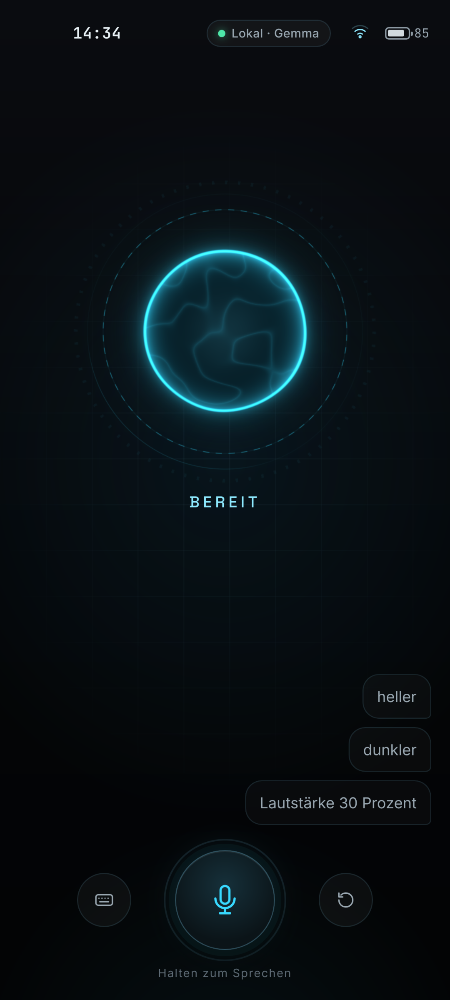
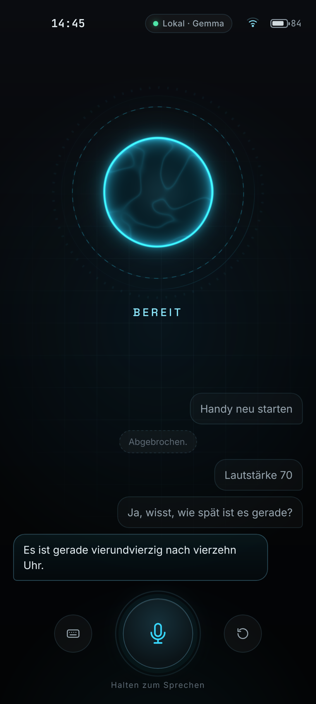
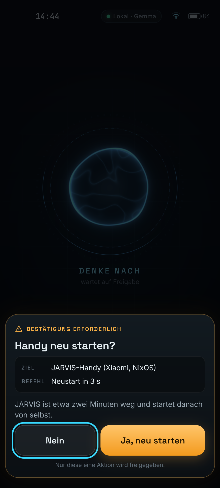
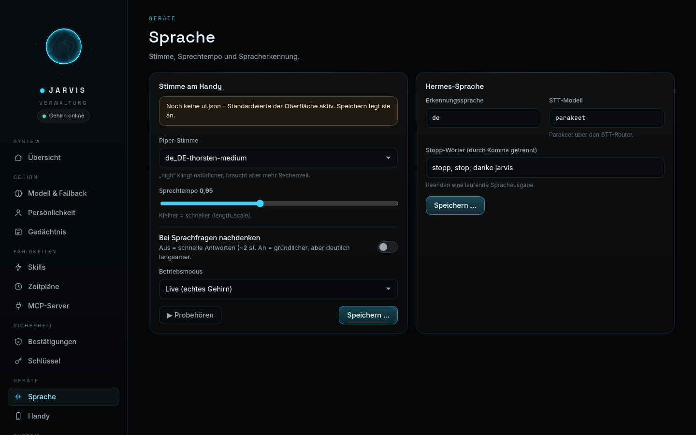
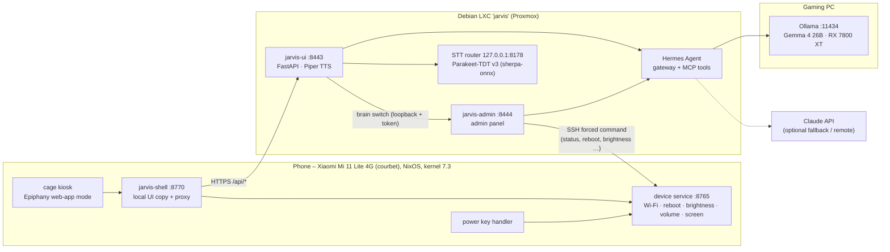

# Jarvis LNX

**An old Xiaomi Mi 11 Lite 4G, reborn as a self-hosted, German-speaking voice assistant terminal.**

The phone runs **NixOS with a mainline Linux 7.3 kernel** – no Android left. A `cage` kiosk shows one thing only:
a full-screen JARVIS web UI with an animated orb. You hold (or tap) the mic button and talk; speech recognition,
the language model and speech synthesis all run on your own hardware at home. A cloud model (Claude) is optional,
as a fallback or on demand.

<p align="center">
  
  
  
</p>
<p align="center">
  
</p>

The UI is in German (screenshots: idle orb with local commands, a spoken question answered in ~3 s,
a confirmation card before rebooting the phone, and the admin panel's voice page).

---

## What it does

- **Talk to it in German.** Push-to-talk (hold) or tap-to-talk (hands-free with end-of-speech detection).
  Answers are spoken back by a local Piper voice; the orb reacts to listening / thinking / speaking.
- **Local brain first.** [Hermes Agent](https://github.com/NousResearch/hermes-agent) on a small Debian LXC talks to
  [Ollama](https://ollama.com) on the gaming PC (Gemma 4 26B-A4B QAT, 64k context, on an RX 7800 XT 16 GB).
- **Brain switch: local / auto / remote.** *Local* = only Gemma, everything stays in the house. *Auto* = Gemma while
  the PC is on, otherwise Claude. *Remote* = Claude only (Haiku / Sonnet / Opus), the PC's GPU is freed. Switch from
  the phone (tap the badge, or say "Jarvis, wechsel auf Sonnet") or the admin panel – effective from the next question.
- **Device control with confirmation.** Wi-Fi on/off, reboot, power off, brightness, volume, screen on/off – via an
  MCP tool on the backend that only expresses the *intent*; the phone executes it locally after you tap "Ja" on a
  confirmation card (real touch required, synthetic clicks are ignored). Simple commands like "heller" / "Lautstärke
  30 Prozent" are matched locally in the UI without asking the LLM.
- **Admin web panel** (desktop/tablet): model & fallback, persona, memory, skills, schedules, MCP servers,
  approvals, API keys (masked), voice, phone status, services, logs, backups/undo for every change.
- **Survives being offline.** The phone keeps a local copy of the UI (`jarvis-shell`); without Wi-Fi it shows a
  "Wi-Fi on / reboot" emergency page and returns to JARVIS automatically.

## Architecture



Audio never leaves your network: recording happens on the phone, STT and TTS run on the LXC's CPU. Only in *auto*
(when the PC is off) or *remote* mode are the **text** transcripts sent to Anthropic.

## Hardware & software

| Part | What |
|---|---|
| Phone | Xiaomi Mi 11 Lite 4G (`courbet`, M2101K9AG), Snapdragon 732G (SM7150), Adreno 618, 6 GB RAM, 128 GB UFS |
| Phone OS | NixOS (unstable, `stateVersion 26.11`) via [ElXreno/nixos-courbet](https://github.com/ElXreno/nixos-courbet), kernel [ElXreno/linux](https://github.com/ElXreno/linux) branch `courbet-7.3` |
| Phone UI | `cage` Wayland kiosk + Epiphany (WebKitGTK) in web-app mode, PipeWire/WirePlumber |
| Backend | Proxmox LXC, Debian 13, 6 cores, 12 GB RAM; Python 3.13, FastAPI/uvicorn |
| Agent | [Hermes Agent](https://github.com/NousResearch/hermes-agent) (NousResearch, MIT), manual approvals |
| LLM (local) | [Ollama](https://ollama.com) on a Ryzen 9 5950X + Radeon RX 7800 XT 16 GB; Gemma 4 26B-A4B QAT, 64k ctx, ~33 tok/s |
| LLM (cloud, optional) | Claude Haiku / Sonnet / Opus via the Anthropic API |
| STT | NVIDIA Parakeet-TDT-0.6B-v3 (int8) via [sherpa-onnx](https://github.com/k2-fsa/sherpa-onnx), ~1.5 s per 5 s utterance on CPU |
| TTS | [Piper](https://github.com/OHF-Voice/piper1-gpl) with the [Thorsten](https://www.thorsten-voice.de) voice `de_DE-thorsten-medium`, first audio after 45–240 ms |

## Status (honest)

**Works (tested on the device):**
- NixOS boots from `boot` + `userdata`; display, touch, buttons, speaker + microphone, GPU (with the zap shader),
  Wi-Fi, battery with a 60–80 % charge limit for 24/7 operation on a USB power supply.
- Kiosk comes up full-screen after every reboot (~55 s), JARVIS is the only UI.
- Voice loop speaker → mic → STT → Hermes → TTS, about 3 s for simple questions in local mode.
- Brain switch from phone and admin panel; Claude fallback when the PC is off.
- Confirmation cards for device actions (local patterns and the decline path tested on the device; the full
  reboot-through-the-card path is still in final testing).

**Work in progress / planned:**
- **Own voice:** recording tools and a 1000-sentence corpus are in `voice/`; fine-tuning (Piper, then Kokoro-82M) not done yet.
- **Wake word "Hey Jarvis"** via [openWakeWord](https://github.com/dscripka/openWakeWord) on the phone – planned; the UI side exists.
- **Tap-to-talk** (hands-free with silence detection) is implemented but still being tuned with real voices on the phone.
- Device commands through Gemma without "thinking" are hit-and-miss (local pattern matching in the UI is the main path).
- Occasional `dpu frame done timeout` display hang observed once; suspend, modem/telephony, sensors untested.

## Repository layout

```
nixos/     phone NixOS configuration (flake, kiosk, device service, restricted SSH entry)  → nixos/README.md
ui/        jarvis-ui: FastAPI server + orb web UI (static/), phone shell (phone/), test tools
admin/     jarvis-admin: admin panel server + UI, privileged helper (ctl/) for service restarts
scripts/   setup, build, deploy and test scripts (backend-*, handy-* = phone, sprache-* = voice, steuerung-* = control/MCP)
voice/     own-voice recording tools + sentence corpus (WIP)
docs/      screenshots
```

Comments and most docs inside the code are in German.

## Configuration

All private LAN addresses were replaced by placeholders: `JARVIS_HOST` (backend LXC), `PHONE_HOST`,
`OLLAMA_HOST` (GPU PC), `PROXMOX_HOST`, `APT_CACHE_HOST`. See **[`config.env.example`](config.env.example)** for
where each one is used. Shell scripts read them from the environment; for the phone build edit `nixos/site.nix`.

Nothing secret is in this repository. You create your own: SSH keys, the home CA (`ui/make-certs.sh`),
the user password hash, the admin password (set on first login with a one-time code), API keys (entered in
the admin panel, stored in `~/.hermes/.env` on the backend).

## Installation overview

> This is a hobby build log made reusable, not a one-click installer. Expect to adapt paths and names.

1. **Backend LXC** (Debian 13): `scripts/jarvis-lxc-base.sh` (base packages, user `jarvis`), install Hermes Agent
   as user `jarvis`, point it at Ollama. Optionally restrict Ollama's port to the LXC: `scripts/backend-ollama-firewall.sh`.
2. **Voice chain:** `scripts/sprache-jarvis-setup.sh` (Piper + Parakeet), `scripts/sprache-stt-router.py` +
   `.service` (OpenAI-compatible STT endpoint for Hermes on 127.0.0.1:8178).
3. **Certificates:** `ui/make-certs.sh` on the LXC → home CA + server certs for :8443/:8444.
4. **UI:** `ui/deploy.sh` (rsync to the LXC, venv, `jarvis-ui.service`). Has a demo mode (`JARVIS_MODE=demo`).
5. **Admin panel:** `admin/deploy.sh` (+ `admin/ctl/` path-unit helper for restarts). First login asks for a
   one-time setup code printed on the server.
6. **MCP tools for Hermes:** `scripts/steuerung-geraet-install.sh` (device intents), optional
   `scripts/steuerung-claude-*` (Claude fallback, "ask Claude" project tool, limited budget).
7. **Phone:** unlock the bootloader, build and flash NixOS – see [`nixos/README.md`](nixos/README.md). Later updates:
   `scripts/handy-deploy.sh` over Wi-Fi.

Note: the Hermes gateway unit name (`hermes-gateway-<id>.service`) is instance-specific; adjust it in
`admin/server.py` and `admin/ctl/jarvis-admin-ctl.sh`.

## Safety notes – read before touching your phone

- **This wipes the phone.** `userdata` becomes the NixOS root filesystem, `boot` is overwritten and `dtbo` erased.
  Android will not start any more. Back up everything first, including the critical partitions such as `persist`,
  `modemst1/2`, `fsg`, `boot`, `dtbo`, `vbmeta*` (see `scripts/handy-backup.sh`) – keep them safe, they contain
  device-unique calibration data, and the original `boot`/`dtbo` are your way back.
- **Bootloader unlock** is required (Xiaomi's official unlock procedure with a Mi account and waiting period).
  Unlocking voids warranty-related trust states and erases data.
- **Anti-rollback:** this device reported anti-rollback index **3** (`fastboot getvar anti`). **Never flash a MIUI /
  HyperOS fastboot ROM with a lower rollback index** – that can hard-brick the phone. Check your own value first.
  The way back to Android is a ROM/firmware with index ≥ your device's.
- `fastboot boot` (RAM boot) does not work on courbet; testing means flashing.
- Proprietary firmware blobs (GPU zap shader, IPA, Wi-Fi/modem firmware) are **not** included; extract them from
  your own device.
- Ollama has no authentication – do not expose port 11434 beyond the hosts that need it.
- Everything here is provided as-is, without warranty. You can brick your phone. Your responsibility.

## Credits & upstream

- [ElXreno/nixos-courbet](https://github.com/ElXreno/nixos-courbet) and [ElXreno/linux](https://github.com/ElXreno/linux)
  (`courbet-7.3`) – the mainline port that makes all of this possible. Huge thanks.
- [NixOS](https://nixos.org), [cage](https://github.com/cage-kiosk/cage), [Epiphany / WebKitGTK](https://webkitgtk.org)
- [Hermes Agent](https://github.com/NousResearch/hermes-agent) by Nous Research
- [Ollama](https://ollama.com), Google [Gemma](https://ai.google.dev/gemma)
- [sherpa-onnx](https://github.com/k2-fsa/sherpa-onnx) and NVIDIA [Parakeet-TDT-0.6B-v3](https://huggingface.co/nvidia/parakeet-tdt-0.6b-v3)
- [Piper](https://github.com/OHF-Voice/piper1-gpl) and the [Thorsten voice](https://www.thorsten-voice.de) by Thorsten Müller (CC0)
- [Mozilla Common Voice](https://commonvoice.mozilla.org) – German sentences for the voice corpus (CC0)
- Fonts: [Inter](https://github.com/rsms/inter), [JetBrains Mono](https://github.com/JetBrains/JetBrainsMono),
  [Space Grotesk](https://github.com/floriankarsten/space-grotesk) – SIL OFL 1.1, license files in `ui/static/fonts/`
- Optional cloud model: [Claude](https://www.anthropic.com) by Anthropic

## License

Code: [MIT](LICENSE) © 2026 Anarki-LNX. Third-party files keep their own licenses (see `LICENSE`).

## Disclaimer

"JARVIS" is just a hobby name for this assistant. This project is not affiliated with, endorsed by or connected to
Marvel, Disney or any of their properties. Xiaomi, Snapdragon, Claude, Gemma and other names are trademarks of their
respective owners.

---

## Kurzfassung (Deutsch)

**Jarvis LNX** macht aus einem alten Xiaomi Mi 11 Lite 4G ein selbst gehostetes Sprachassistenz-Terminal. Auf dem
Handy läuft **NixOS mit Mainline-Kernel 7.3** (Port von ElXreno), ein `cage`-Kiosk zeigt ausschließlich die
JARVIS-Oberfläche mit animiertem Orb. Im Hintergrund arbeitet **Hermes Agent** in einem Debian-LXC mit **Gemma 4 26B**
über Ollama auf dem eigenen PC; Claude ist optional als Ausweich- oder Remote-Gehirn (Schalter Lokal / Automatisch /
Remote). Spracherkennung (**Parakeet-TDT v3**) und Sprachausgabe (**Piper, Thorsten-Stimme**) laufen lokal auf der CPU.
Gerätebefehle (WLAN, Neustart, Helligkeit …) laufen über MCP und werden erst nach einer Bestätigungskarte auf dem
Handy ausgeführt. Ein Admin-Panel verwaltet Modell, Persona, Gedächtnis, Skills, Schlüssel und Dienste.

**Stand:** Läuft im Alltag. In Arbeit: eigene Stimme, Wake-Word „Hey Jarvis“ (openWakeWord), Feinschliff
Tippen-zum-Sprechen.

**Achtung:** Bootloader-Entsperrung nötig, Android-Daten werden gelöscht. Anti-Rollback-Index des Geräts beachten
(hier 3) – **niemals MIUI mit niedrigerem Index flashen**. Proprietäre Firmware ist nicht enthalten.
Alle privaten Adressen sind durch Platzhalter ersetzt (`config.env.example`).
